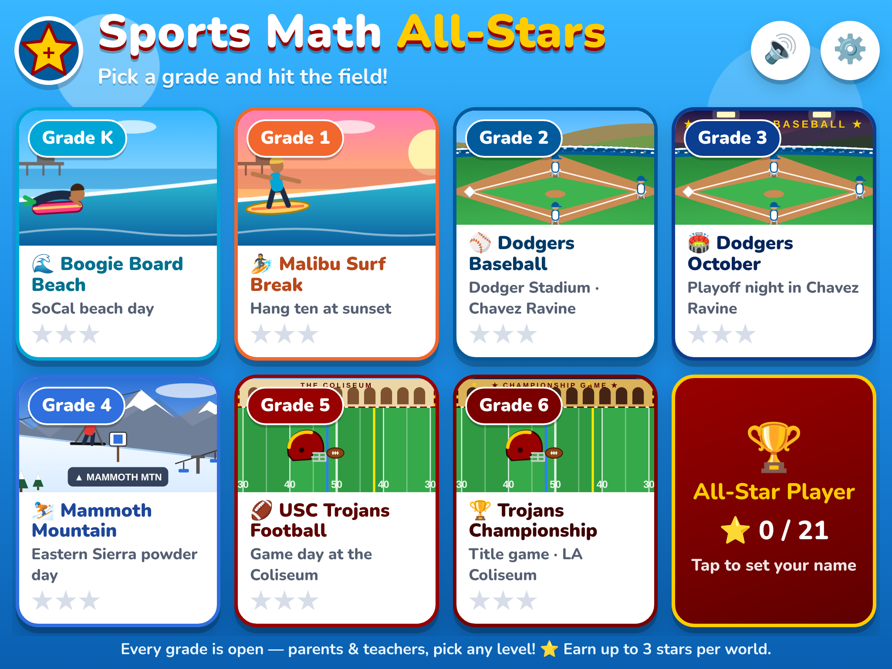
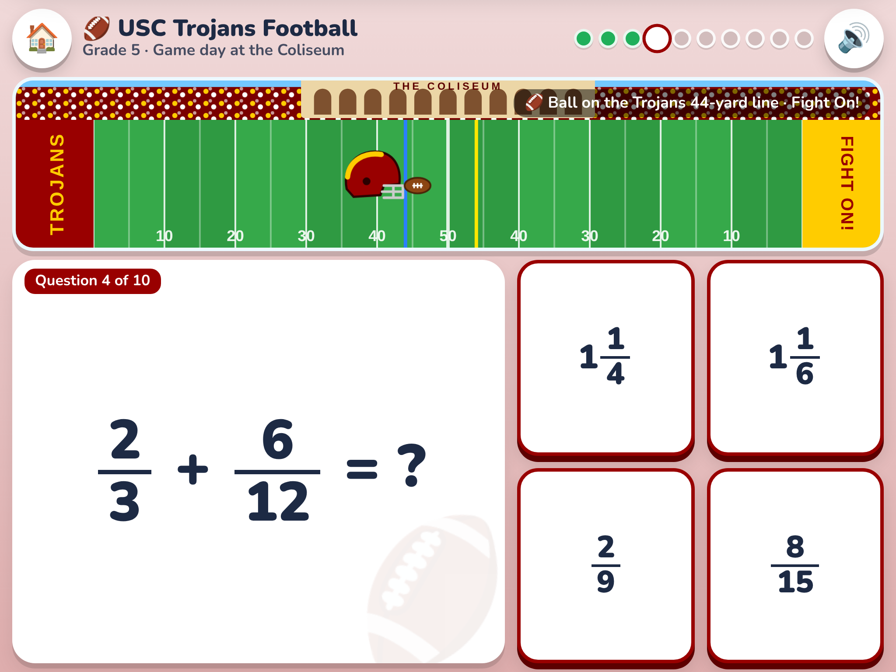
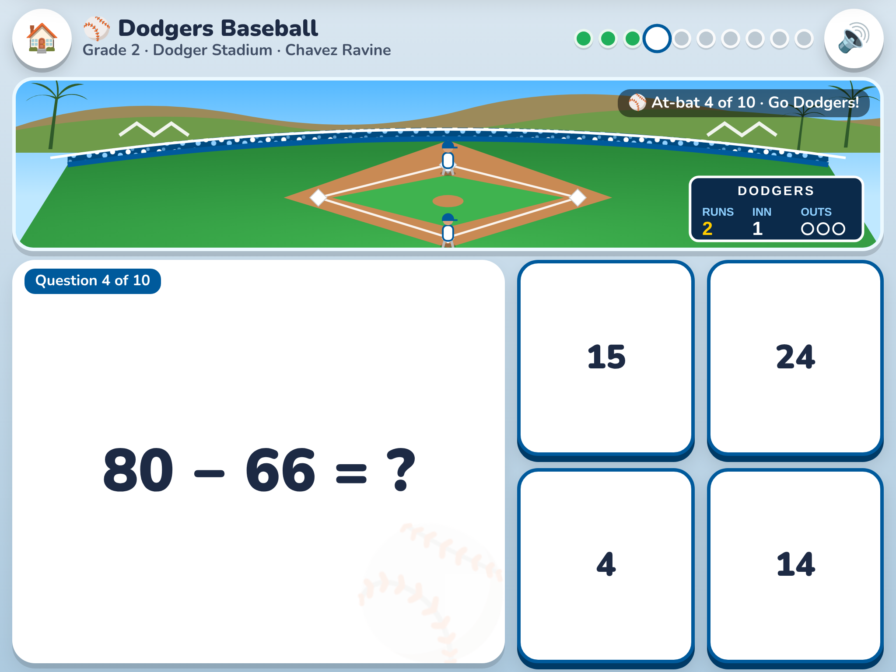
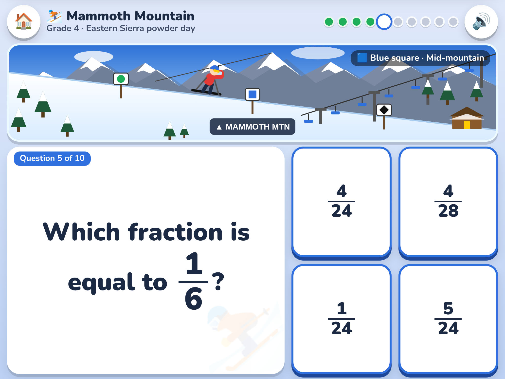

# Sports Math All-Stars

A browser-based math game for kids in kindergarten through 6th grade. Each grade is its own sports world, themed around USC Trojans football, the LA Dodgers, Mammoth Mountain skiing, surfing, and boogie boarding.

**Play it:** https://jirvine1220-droid.github.io/sports-math-all-stars/

It's built for iPad and Android tablets. Open the link in Safari or Chrome, then use "Add to Home Screen" so it opens full screen like an app.

## Levels

| Grade | World | Math topics |
|---|---|---|
| K | Boogie Board Beach | Counting to 20, more or fewer, adding and subtracting within 10 |
| 1 | Malibu Surf Break | Adding and subtracting within 20, tens and ones, comparing numbers |
| 2 | Dodgers Baseball | 2-digit adding and subtracting, coins, telling time, skip counting |
| 3 | Dodgers October | Multiplication and division facts, rounding, fractions, area |
| 4 | Mammoth Mountain | Multi-digit multiplication, long division, equivalent fractions |
| 5 | USC Trojans Football | Decimals, fractions with unlike denominators, volume, order of operations |
| 6 | Trojans Championship | Ratios, percents, negative numbers, one-step equations, exponents, averages |

Each round is 10 randomly generated questions with big tap-to-answer buttons. Kids earn 1 to 3 stars per level, and progress is saved on the device.

## About

The whole game is one self-contained file, `index.html`, with no dependencies, and it works offline. All artwork is drawn in code. Team names are used for theming only; this is an unofficial fan project, not affiliated with USC, the Los Angeles Dodgers, or Mammoth Mountain.
